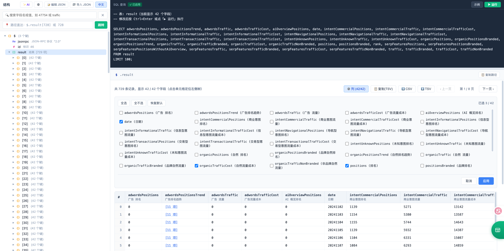

[English](README_EN.md) | 简体中文

# JSON on SQL

> 🚀 **极速 JSON 分析利器：秒开百兆大文件 · 原生 SQL 查询 · 一键转表格导出**

👉 **在线体验:** [https://jsononsql.com](https://jsononsql.com)

## 📸 效果预览

<!-- 提示：截一张图命名为 demo.png 放在同级目录，这里就会显示 -->


## ✨ 核心特性

- **⚡ 超大文件秒开**：采用底层虚拟渲染与懒加载机制。左侧结构树按需展开，右侧表格自动分页。告别上百 MB 文件打开即卡死的痛点。
- **🔍 原生 SQL 查询**：内置自研轻量级 SQL 引擎。无需导入数据库，直接在页面上使用 `SELECT`、`WHERE`、`ORDER BY`、`LIMIT` 查询数据。
- **📊 JSON to Table (一键导出)**：选中嵌套数组，自动渲染为数据表格。支持自由勾选所需字段列，一键复制为 TSV 或下载为 CSV/TSV 文件（自带 BOM 头，兼容 Excel 中文不乱码）。
- **🌍 AI 中英智能翻译**：内置数百个通用词汇。遇到生僻业务词（如电商的 gmv），可配置你自己的 AI 模型 API（兼容 DeepSeek、ChatGPT 等），一键智能翻译并缓存。
- **🔒 100% 本地隐私**：纯前端架构（Vanilla JS），无任何后端服务器。你的数据只在浏览器内存中解析，断网也能正常使用。

## 🚀 快速开始

无需安装 Node.js 或任何构建工具，直接克隆即可运行：

```bash
git clone https://github.com/jkdcjlly-glitch/json-on-sql.git
cd json-on-sql
```

使用任意静态服务器启动（如 Python）：

```bash
python3 -m http.server 8000
```

访问 `http://localhost:8000` 即可。

## ☁️ 部署

本项目没有任何后端依赖，推荐一键部署到 **Cloudflare Pages** 或 **Vercel**，并绑定你的自定义域名。

## 🤝 贡献与反馈

非常欢迎提交 Issue 或 Pull Request！
- 提交 Issue: 请说明你的 JSON 文件大小、浏览器版本和复现步骤。
- 提交 PR: 请在本地测试通过后再提交。

## 📄 开源协议

[MIT License](LICENSE)