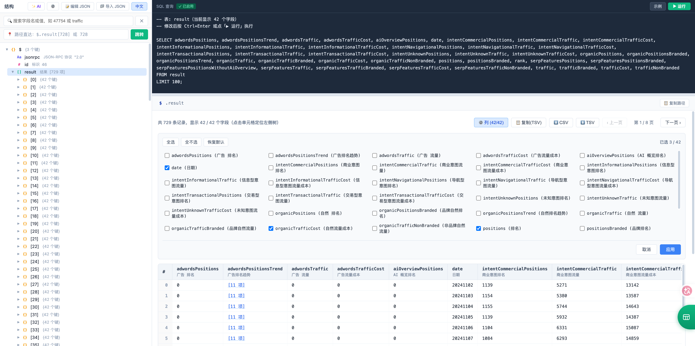

English | [简体中文](README.md)

# JSON on SQL

> 🚀 **A fast, pure frontend JSON viewer with native SQL query, table export, and AI translation.**

👉 **Live Demo:** [https://jsononsql.com](https://jsononsql.com)

## 📸 Screenshots

<!-- Tip: Take a screenshot, name it demo.png, and place it in the root directory -->


## ✨ Features

- **⚡ Blazing Fast for Large Files**: Built with virtual rendering and lazy loading. The DOM tree only renders what you see, preventing browser crashes even with 100MB+ files.
- **🔍 Native SQL Query**: Includes a built-in lightweight SQL engine. Query your JSON arrays directly using `SELECT`, `WHERE`, `ORDER BY`, and `LIMIT`.
- **📊 JSON to Table / CSV**: Automatically flattens nested arrays into data tables. Select specific columns and export to Excel-ready CSV or TSV files with one click (BOM included).
- **🌍 AI-Powered Translation**: Don't struggle with cryptic camelCase keys. Configure your own AI API key (DeepSeek, OpenAI, etc.) to auto-translate JSON keys into your native language, with local caching.
- **🔒 100% Privacy**: No backend, no tracking. Your data is parsed entirely in your browser's memory. Works perfectly offline.

## 🚀 Quick Start

No Node.js or build tools required.

```bash
git clone https://github.com/jkdcjlly-glitch/json-on-sql.git
cd json-on-sql
```

Serve the static files using any HTTP server:

```bash
python3 -m http.server 8000
```

Open `http://localhost:8000` in your browser.

## ☁️ Deployment

Deploy directly to **Cloudflare Pages** or **Vercel** with zero configuration.

## 🤝 Contributing

Issues and Pull Requests are highly welcome!

## 📄 License

[MIT License](LICENSE)